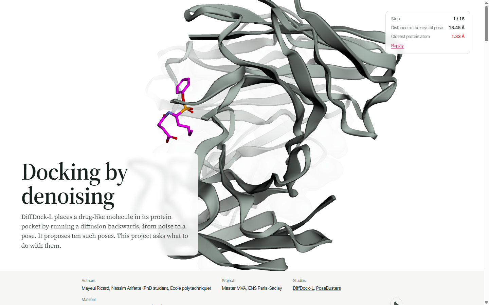

# Docking by denoising

**DiffDock-L generates candidate poses of a ligand in its protein pocket by reversing a diffusion. This project asks what to do with them: can physical checks, independent scoring and local refinement pick a better pose from a fixed pool?**

[**Open the interactive article →**](https://nassim-arifette.github.io/diffdock-geometric-diffusion-docking/)

[](https://nassim-arifette.github.io/diffdock-geometric-diffusion-docking/)

## What the site shows

Everything on the page comes from one archived DiffDock-L run on a T4 GPU (PDB 1A0Q, ten candidates), recomputed with this repository's own evaluation code.

| Figure | Try this |
| --- | --- |
| Three kinds of freedom | Translate, rotate and twist the crystal ligand in its pocket, and watch its RMSD and its closest protein contact. |
| Running the diffusion backwards | Scrub through the real recorded denoising frames of any of the ten candidates. |
| Ten candidates, none of them right | Confidence against RMSD, and the PoseBusters checks of every pose, with clashing atoms highlighted. |
| Four ways to choose | The frozen protocol of the pose-selection pilot. |

**What the 1A0Q run says.** None of the ten candidates is within 2 Å of the crystal pose (the closest is 3.74 Å, ranked eighth), and every one of them fails the two protein-contact checks. The crystal ligand passes them against the same receptor. A better ranker cannot fix such a pool, which is why the pilot measures generation and selection separately. This is one acceptance example, not a benchmark result.

## The pilot

Fixed DiffDock-L candidates (20 per complex and seed, 3 seeds) on 5 development and 20 evaluation complexes from the 308-case PoseBusters set, compared under four selectors:

| Variant | Rule |
|---|---|
| A | Rank raw candidates by DiffDock confidence |
| B | Keep physically valid candidates, then rank by confidence |
| C | Keep valid candidates, then rank by GNINA `CNNscore` |
| D | Minimise every candidate with GNINA, recheck validity, rank by `CNNscore` |

No selector sees the reference pose; an empty filtered pool counts as failure. The primary outcome is a top-1 pose that is both within 2 Å and physically valid. **Pilot results are not published yet**: they will be added with their manifests, raw poses and logs.

```bash
python -m docking_tools.pilot_dataset --out /content/posebusters_pilot
python -m docking_tools.pilot --manifest /content/posebusters_pilot/pilot_manifest.json --split dev --out /content/pilot_dev
python -m docking_tools.pilot --manifest /content/posebusters_pilot/pilot_manifest.json --split eval --out /content/pilot_eval
python -m docking_tools.pilot_summary /content/pilot_eval
```

Pass `--gnina /path/to/gnina` to enable C and D. Full protocol, data choices and limits: [`docs/research.md`](docs/research.md) (French).

## Run it

The notebooks run in a Colab GPU runtime; DiffDock itself needs a separate pinned Python 3.9 / torch 1.13.1 environment, which the docking notebook installs.

| Notebook | Purpose |
|---|---|
| [01_geometry](notebooks/01_geometry.ipynb) | Translations, rotations and bond-axis torsions, with numerical checks |
| [02_docking_colab](notebooks/02_docking_colab.ipynb) | Pinned install, one complex, verified poses, manifest and export |
| [03_pdbbind_benchmark_prep](notebooks/03_pdbbind_benchmark_prep.ipynb) | PDBBind preparation, for users with those data |
| [04_pose_inspector](notebooks/04_pose_inspector.ipynb) | Saved poses, reference overlay, validity checks and real sampler frames |
| [05_fixed_candidate_pilot](notebooks/05_fixed_candidate_pilot.ipynb) | The PoseBusters pilot and its paired comparison |

Headless GPU runs from the command line are described in [`docs/COLAB.md`](docs/COLAB.md). Local checks need no GPU:

```bash
python -m pip install -r requirements-dev.txt   # Python 3.11
python -m pytest tests -q
python -m docking_tools.evaluation /path/to/run
python -m docking_tools.inspector /path/to/run
```

## Scope and limits

- **One acceptance case is not a benchmark.** The 1A0Q run checks that the pipeline works end to end.
- **Splits are PDB-disjoint, not protein-family-disjoint**, and the checkpoint's training overlap with PoseBusters is not audited.
- **Receptors with metals or covalent links are excluded**, and waters, ions and other heteroatoms are removed.
- **Filtering, rescoring and refinement are established methods** (DiffDock-Glide, Matcha). The contribution is a transparent comparison and failure analysis at a fixed generation budget.
- **The baseline is DiffDock-L**, not the original 2023 checkpoint. Every run records upstream commit, weights, inputs, seed, parameters, GPU and timings.

## Repository layout

| Path | Role |
| --- | --- |
| `docking_tools/` | Docking runs, evaluation (RDKit, PoseBusters, RMSD), selectors, pilot, inspector |
| `notebooks/` | Colab notebooks, generated by `tools/build_notebooks.py` |
| `tests/` | Geometry, failure recording, evaluation, pilot and inspector tests |
| `docs/` | Research note, Colab and GNINA guides, validation status |
| `report/` | Revision note for the original course report |
| `web/` | Source of the website (Vite + TypeScript, 3Dmol.js, D3). See [`docs/SITE.md`](docs/SITE.md) |

## History and credits

The original course report, slides and notebooks are kept as artifacts. Read the [revision note](report/revision.md) before citing them: it corrects the 6AGT ligand identity, the reading of confidence as affinity, and the confusion between pose validity and synthesizability.

DiffDock and DiffDock-L are by Gabriele Corso and colleagues ([code](https://github.com/gcorso/DiffDock)); PoseBusters by Buttenschoen, Morris and Deane; GNINA by McNutt and colleagues.

Mayeul Ricard and Nassim Arifette (PhD student, École polytechnique). Master MVA, ENS Paris-Saclay.
